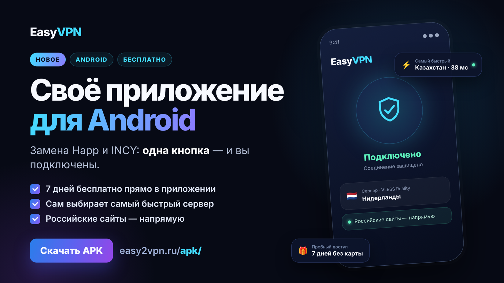

# EasyVPN для Android

Официальное приложение сервиса [EasyVPN](https://easy2vpn.ru/?utm_source=github) для Android. Подключение по подписке EasyVPN одной кнопкой: настройки, протокол и сервер уже выбраны.

**[⬇️ Скачать последнюю версию (APK)](https://github.com/Dsavushkin/easyvpn-android/releases/latest)** · [Страница приложения](https://easy2vpn.ru/prilozhenie-android.html?src=github) · [Поддержка в Telegram](https://t.me/easy2vpnsupport)

## Возможности

- **Одна кнопка** — открыли приложение, нажали «Подключить».
- **Пробный доступ на 7 дней прямо в приложении** — без карты.
- **Самый быстрый сервер** — приложение проверяет серверы настоящим запросом и показывает, какой отвечает быстрее.
- **Российские сайты напрямую** — банки, госуслуги и маркетплейсы работают без VPN (можно выключить в настройках).
- **Напоминание о продлении** за 3 дня и за день до окончания подписки.
- **Без рекламы.** Приложение не записывает, какие сайты вы открываете.
- Протокол VLESS с Reality.
- Подходит и тем, кто раньше подключался через Happ или INCY: подписка та же.

## Установка

1. Скачайте файл `easyvpn-android-<версия>-beta.apk` из раздела [Releases](https://github.com/Dsavushkin/easyvpn-android/releases/latest).
2. Откройте файл и разрешите установку из этого источника (Android спросит один раз).
3. Нажмите «Получить 7 дней бесплатно» или «Вставить ссылку», если подписка уже есть.
4. Нажмите большую кнопку подключения и разрешите VPN-подключение.

Требования: Android 7.0 и новее.

## Проверка файла

Каждый релиз содержит контрольную сумму SHA-256. Сравните её с суммой скачанного файла — она же указана на [странице приложения](https://easy2vpn.ru/prilozhenie-android.html?src=github).

## Конфиденциальность

Приложение отправляет только обезличенную статистику (версия, запуск, успешность подключения) — её можно выключить в настройках. Подробнее — в [политике конфиденциальности](https://easy2vpn.ru/privacy.html#app).

## Сторонние компоненты

Приложение использует Xray-core (MPL-2.0), flutter_vless (MIT) и tun2socks (GPL-3.0). Лицензии — в приложении: «Настройки → О приложении». Исходный код компонентов под GPL предоставляется по запросу на info@easy2vpn.ru.

---

**EasyVPN for Android** — the official app of the EasyVPN service. One-tap connection with your EasyVPN subscription, 7-day free trial in the app, automatic fastest-server choice, no ads. [Download the latest APK](https://github.com/Dsavushkin/easyvpn-android/releases/latest).
